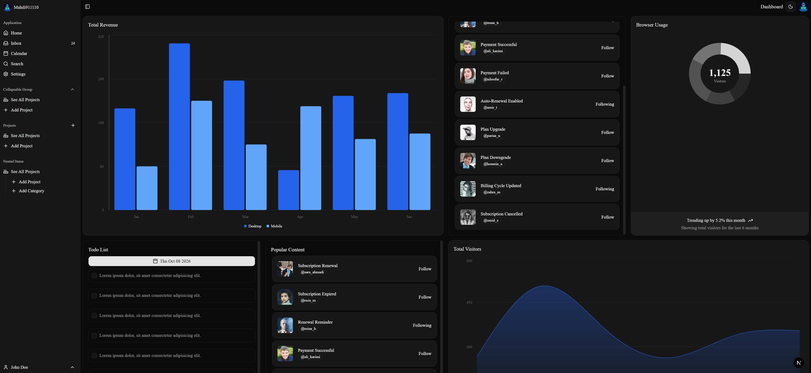
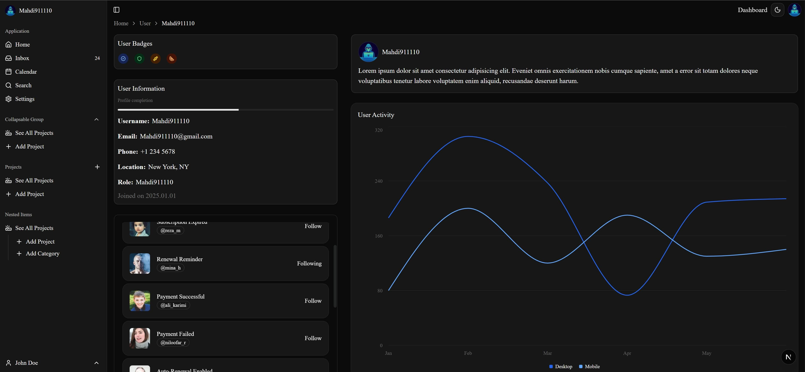
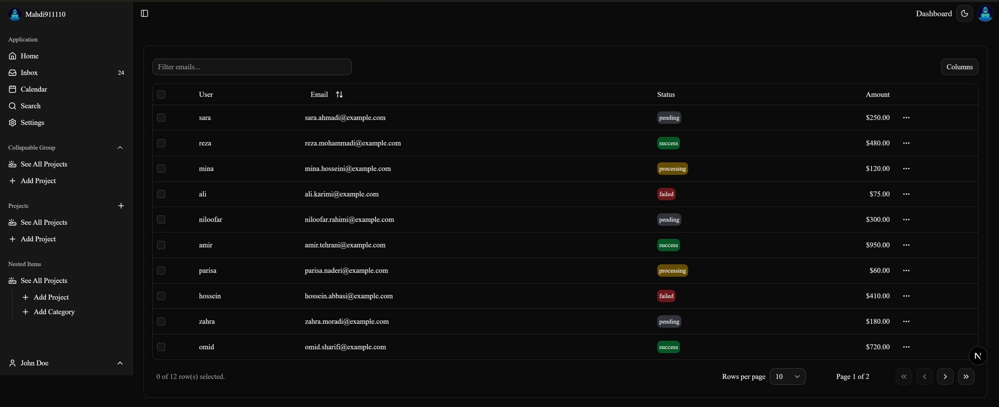

<h1 align="center">SaaS Admin Dashboard</h1>

<p align="center">
  
  
  
  
  
  
  
  
</p>

A modern SaaS admin dashboard built with **Next.js App Router**, **TypeScript**, **shadcn/ui**, **Base UI**, **Tailwind CSS**, **Recharts**, and **TanStack Table**.

This project was built as a learning-focused admin dashboard to practice building reusable UI with shadcn/ui, responsive dashboard layouts, interactive charts, data tables, theme switching, sidebar navigation, scrollable panels, and common SaaS dashboard patterns.

> **Status:** UI/demo project. The current data is static/mock data and there is no backend, authentication, or database integration yet.

## ✨ Features

- 📊 Dashboard overview with multiple chart types
  - Multiple bar chart
  - Area chart with gradient
  - Donut chart with total visitors
  - Multiple line chart on the user page
- 📋 Payments data table
  - Column sorting
  - Email filtering
  - Column visibility
  - Row selection
  - Pagination
  - Rows-per-page selection
  - Row action menu
- 👤 User profile page
  - User information
  - Profile completion progress
  - User badges
  - Recent transactions
  - User activity chart
  - Breadcrumb navigation
- 🧭 Collapsible sidebar
  - Icon-only collapsed state
  - Application navigation
  - Collapsible groups
  - Nested menu items
  - Project sections
  - User menu
- 🌙 Light / dark / system theme
- 📅 Calendar with date selection
- ☑️ Todo list with checkboxes
- 🃏 Reusable transaction/content cards
- 🖱️ Hover cards, dropdown menus, popovers, tooltips, badges, avatars, progress indicators, and other UI primitives
- 📱 Responsive grid-based dashboard layout
- ♿ Accessible UI primitives powered by Base UI
- 🎨 shadcn/ui **Nova** preset with **Lucide** icons and **Geist** typography
- 🧩 Component source owned directly by the project through shadcn/ui

## 🛠️ Tech Stack

| Technology | Version / Role |
| --- | --- |
| [Next.js](https://nextjs.org/) | 16.3.6 — App Router |
| [React](https://react.dev/) | 19.2.8 |
| [TypeScript](https://www.typescriptlang.org/) | 5.x |
| [Tailwind CSS](https://tailwindcss.com/) | 4.3.3 |
| [shadcn/ui](https://ui.shadcn.com/) | 4.21.3 |
| [Base UI](https://base-ui.com/) | 1.8.0 — headless UI primitives |
| [Lucide](https://lucide.dev/) | 1.52.0 — icons |
| [Recharts](https://recharts.org/) | 3.8.0 — charts |
| [TanStack Table](https://tanstack.com/table) | 9.2.6 — data table |
| [next-themes](https://github.com/pacocoursey/next-themes) | 0.4.6 — theme management |
| [React Day Picker](https://daypicker.dev/) | 10.0.2 — calendar |
| [date-fns](https://date-fns.org/) | 4.4.0 — date utilities |
| [class-variance-authority](https://cva.style/) | 0.7.1 — component variants |

The versions above reflect the project's `package-lock.json` at the time this README was created. Package ranges in `package.json` may allow newer compatible patch/minor releases.

## 🎨 shadcn/ui Setup

The project uses the current shadcn/ui setup with **Base UI** as its component primitive library.

The project's `components.json` is configured with:

- Style: `base-nova`
- Base color: `neutral`
- CSS variables: enabled
- Icon library: Lucide
- RTL: disabled
- Tailwind CSS v4
- React Server Components support

shadcn/ui places component source code directly in the project rather than hiding the implementation behind a traditional package API. This makes the UI components easy to inspect and customize.

Official documentation:

- [shadcn/ui](https://ui.shadcn.com/)
- [shadcn/ui components](https://ui.shadcn.com/docs/components)
- [Base UI](https://base-ui.com/)

## 📈 Charts

The dashboard uses Recharts through reusable shadcn chart components.

Current charts include:

- **Total Revenue** — multiple bar chart
- **Total Visitors** — stacked area chart with gradients
- **Browser Usage** — donut chart with a total in the center
- **User Activity** — multiple line chart

The chart configuration uses CSS custom properties such as `--chart-1` through `--chart-7`, allowing the chart palette to work with the application's light/dark theme.

## 📋 Payments Table

The `/payments` route demonstrates a feature-based TanStack Table v9 setup.

Implemented features:

- Column filtering
- Column visibility
- Row selection
- Sorting
- Pagination
- Custom filter and sorting functions
- Payment action menu

The feature configuration is intentionally separated into `data-table-features.ts`:

```text
columnFilteringFeature
columnVisibilityFeature
rowPaginationFeature
rowSelectionFeature
rowSortingFeature
filteredRowModel
paginatedRowModel
sortedRowModel
filterFns
sortFns
```

This follows TanStack Table v9's feature-oriented architecture, where optional table capabilities are explicitly registered.

## 🗺️ Routes

| Route | Purpose |
| --- | --- |
| `/` | Main SaaS dashboard |
| `/payments` | Payments data table |
| `/user/[username]` | User profile/details page |

Next.js App Router uses file-system routing, so the route structure maps directly to the folders under `src/app`.

## 📁 Project Structure

```text
saas-app/
├── src/
│   ├── app/
│   │   ├── payments/
│   │   │   ├── columns.tsx
│   │   │   ├── data-table-features.ts
│   │   │   ├── data-table-pagination.tsx
│   │   │   ├── data-table.tsx
│   │   │   └── page.tsx
│   │   │
│   │   ├── user/
│   │   │   └── [username]/
│   │   │       └── page.tsx
│   │   │
│   │   ├── globals.css
│   │   ├── icon.svg
│   │   ├── layout.tsx
│   │   └── page.tsx
│   │
│   ├── components/
│   │   ├── providers/
│   │   │   └── theme-provider.tsx
│   │   ├── ui/
│   │   │   └── ... shadcn/ui components
│   │   ├── AppSidebar.tsx
│   │   ├── BreadcrumbDemo.tsx
│   │   ├── CalendarMemo.tsx
│   │   ├── CardList.tsx
│   │   ├── ChartAreaGradient.tsx
│   │   ├── ChartBarMultiple.tsx
│   │   ├── ChartLineMultiple.tsx
│   │   ├── ChartPieDonutText.tsx
│   │   ├── Header.tsx
│   │   ├── Information.tsx
│   │   ├── TodoList.tsx
│   │   ├── UserBadge.tsx
│   │   └── UserDescribe.tsx
│   │
│   ├── data/
│   │   └── data.ts
│   │
│   ├── hooks/
│   │   └── use-mobile.ts
│   │
│   └── lib/
│       └── utils.ts
│
├── components.json
├── next.config.ts
├── postcss.config.mjs
├── tsconfig.json
├── eslint.config.mjs
├── package.json
├── README.md
└── package-lock.json
```

## 📸 Preview

### Home Page



### User Page



### Payments Page




## 🧱 Architecture

### Root Layout

`src/app/layout.tsx` provides the application shell:

```text
RootLayout
├── ThemeProvider
│   └── SidebarProvider
│       ├── AppSidebar
│       └── Main
│           ├── Header
│           └── Page content
```

The layout uses `next/font` for Geist and keeps the dashboard shell shared between routes.

### Reusable UI

The `src/components/ui` directory contains the shadcn/ui component source used by the application.

Examples include:

- Button
- Card
- Avatar
- Badge
- Checkbox
- Calendar
- Dropdown Menu
- Field
- Hover Card
- Input
- Popover
- Progress
- Scroll Area
- Select
- Sidebar
- Table
- Tooltip

### Dashboard Components

Application-specific components live outside `components/ui`:

```text
components/
├── AppSidebar.tsx
├── Header.tsx
├── CardList.tsx
├── TodoList.tsx
├── Information.tsx
├── UserBadge.tsx
├── UserDescribe.tsx
└── Chart*.tsx
```

This keeps generated/base UI primitives separate from application-level components.

## 🚀 Getting Started

### Prerequisites

- Node.js
- npm

### Installation

Clone the repository and install dependencies:

```bash
git clone <your-repository-url>
cd saas-app
npm install
```

### Development

```bash
npm run dev
```

Open:

```text
http://localhost:3000
```

### Production build

```bash
npm run build
```

### Start production server

```bash
npm run start
```

### Lint

```bash
npm run lint
```

## 🧩 Adding shadcn Components

The project uses the shadcn CLI to add components.

For example:

```bash
npx shadcn@latest add dialog
```

The component source is then available under:

```text
src/components/ui/
```

Because shadcn/ui provides the component source directly in the project, those components can be customized according to the application's needs.

## 🎯 Learning Goals

This project was built primarily as a hands-on learning project around:

- Next.js App Router
- TypeScript
- shadcn/ui
- Base UI
- Tailwind CSS
- Responsive dashboard layouts
- Sidebar patterns
- Dark mode
- Accessible UI primitives
- Reusable React components
- Recharts
- TanStack Table v9
- Client-side table state
- Filtering, sorting, pagination, and row selection
- Calendar and popover interactions
- CSS Grid and Flexbox sizing
- Scrollable dashboard panels

## 🔮 Future Improvements

The current project is a UI/demo implementation. A production-oriented version could add:

- Authentication and authorization
- Database integration
- Real user and payment data
- API routes / Server Actions
- CRUD operations
- Persistent todos
- Real analytics
- Search and global filtering
- Notifications
- Settings pages
- Form validation with React Hook Form + Zod
- Loading, error, and empty states
- Route-aware sidebar active states
- Mobile navigation improvements
- Better SEO and page metadata
- Automated tests

## ⚠️ Current Project Notes

### Mock data

Dashboard cards, charts, user information, and payments currently use local/static data. They are intended for UI development and learning rather than production use.

### Avatar asset

Several components reference:

```text
/public/images/avatar.jpg
```

That file is **not present in the provided project archive**. Add the image to `public/images/avatar.jpg`, or replace those references with an available asset before deploying.

### Metadata

The current root layout still contains the default Create Next App metadata:

```text
title: "Create Next App"
description: "Generated by create next app"
```

For a finished portfolio/deployment version, these should be replaced with the actual product name and description.

### Navigation

Several sidebar links currently point to `/` as placeholders. They can be connected to their intended routes once the corresponding pages are implemented.

## 📚 Official References

- [Next.js App Router](https://nextjs.org/docs/app)
- [Next.js Metadata API](https://nextjs.org/docs/app/getting-started/metadata-and-og-images)
- [Next.js Font Optimization](https://nextjs.org/docs/app/getting-started/fonts)
- [shadcn/ui](https://ui.shadcn.com/)
- [shadcn/ui Components](https://ui.shadcn.com/docs/components)
- [Base UI](https://base-ui.com/)
- [Tailwind CSS](https://tailwindcss.com/)
- [TanStack Table](https://tanstack.com/table/latest/docs)
- [Recharts](https://recharts.org/)
- [next-themes](https://github.com/pacocoursey/next-themes)
- [React DayPicker](https://daypicker.dev/)

## 📄 License

This project is licensed under the **MIT License**.

See the `LICENSE` file for more information.

## 👨‍💻 Author

**Mahdi Gorbany**

- GitHub: [@mahdi911110](https://github.com/mahdi911110)

## 🙌 Acknowledgements

- Favicons from [SVG Repo](https://www.svgrepo.com/) and **Lucide-React**.
- Built with ❤️ using **React** and **NEXTJS**.